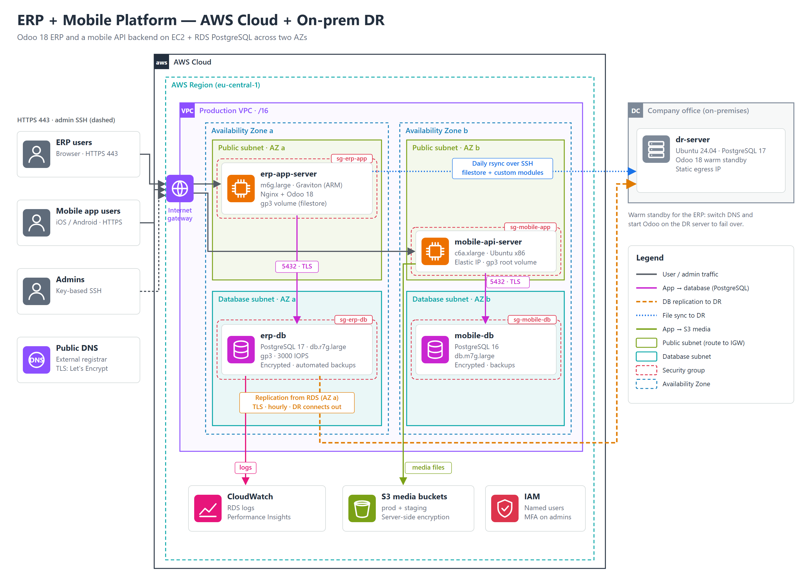
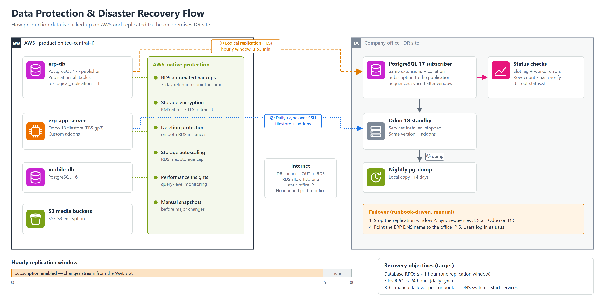

# ERP + Mobile Platform on AWS

**Production AWS infrastructure for an Odoo 18 ERP and a mobile-app backend: EC2 (Graviton + x86), Amazon RDS for PostgreSQL, S3 and a VPC across two production Availability Zones, with an on-premises disaster-recovery site.**


## Context

A mid-size company runs two business-critical systems on AWS:

| System | What it does | Runs on |
|---|---|---|
| **ERP** | Odoo 18: accounting, sales, inventory, HR. Used daily by staff. | EC2 `m6g.large` (Graviton / ARM) + RDS PostgreSQL 17 |
| **Mobile platform** | API backend for an iOS / Android app, with user media in S3 | EC2 `c6a.xlarge` (x86) + RDS PostgreSQL 16 + S3 |

I run this platform as the company's DevOps engineer. My work covers:
- building the Odoo 18 environment and migrating it from an older Odoo 14 stack;
- network and security-group design;
- database operations;
- backups and the disaster-recovery site;
- cost control.

## Architecture at a glance

| Layer | Design |
|---|---|
| **Network** | One production VPC. Production runs in 2 AZs (ERP in one, mobile in the other); a third AZ is kept for testing. Public subnets for the app servers, a separate set of database subnets in an RDS subnet group, and an Internet Gateway. |
| **Edge / TLS** | Nginx reverse proxy on each app server, with Let's Encrypt certificates (Certbot auto-renew). HTTP → HTTPS redirect, and websocket / longpolling routing for Odoo. |
| **Compute** | Right-sized per workload: Graviton (ARM) for Odoo, about 20% cheaper per vCPU than x86, and compute-optimized x86 for the mobile API. Elastic IPs give stable addresses. |
| **Database** | Amazon RDS for PostgreSQL 17 (ERP) and 16 (mobile). gp3 storage with provisioned IOPS, storage autoscaling and custom parameter groups. **TLS enforced** (`rds.force_ssl=1`), **encrypted at rest**, deletion protection on. |
| **Storage** | S3 buckets for app media (prod + staging), with server-side encryption. |
| **Access control** | Security groups restrict each database port to its app server and one allow-listed office IP. IMDSv2 is enforced on the ERP host. |
| **Observability** | RDS logs exported to CloudWatch Logs, and Performance Insights on both databases. |
| **Resilience** | RDS automated backups with point-in-time restore. An **on-premises warm standby** for the ERP is fed by PostgreSQL **logical replication** from RDS. |

Details: [docs/01-architecture.md](docs/01-architecture.md).

## Disaster recovery

The ERP has a warm standby in the company office, so the business can keep working if the AWS region becomes unavailable.





- **Database:** RDS publishes all tables, and the office server subscribes over TLS during an hourly window. The DR side always connects out, so no inbound port is opened at the office.
- **Files:** a daily `rsync` copies the Odoo filestore and custom modules.
- **Targets:** RPO about 1 hour for the database and 24 hours for files. Failover follows a manual runbook.

The full build, scripts and lessons learned are in a separate repo: **[odoo-pg-logical-dr](https://github.com/altaheri86/odoo-pg-logical-dr)**.

## Highlights

- **Odoo 14 → 18 migration** onto a new Graviton instance and a new RDS PostgreSQL 17 database. The old stack was archived (AMI + final RDS snapshot) and then shut down.
- **Cross-architecture DR:** logical replication from RDS (ARM) to an on-premises x86 server. 1,292 tables and 61.7 million rows were verified identical in the rehearsal.
- **Database operations:**
  - custom parameter groups (connection limits, statement timeouts);
  - logical-replication readiness;
  - scripted `pg_dump` / `pg_restore` for prod → test refreshes;
  - storage autoscaling.
- **Cost awareness:**
  - Graviton for the largest workload;
  - gp3 storage with provisioned IOPS for the ERP database;
  - monthly review of spend by service in Cost Explorer.
- **IAM hygiene:** MFA on admin accounts, read-only CLI audits of users and access keys, and policy updates for AWS lifecycle changes, such as the 2027 CloudWatch Logs ARN change.
- **Documentation as code:** the architecture diagrams are generated from a Python script (SVG). A read-only [inventory script](scripts/aws-inventory.sh) keeps the documentation in sync with the real account.

## Repository layout

```
README.md                    this case study
docs/
  01-architecture.md         network, compute, database, storage — design and reasoning
  02-security.md             controls in place and how they are layered
  03-operations.md           backups, restores, patching, monitoring, cost
  04-roadmap.md              planned next iteration of the platform
diagrams/                    architecture + DR diagrams (SVG source, PNG render)
scripts/
  aws-inventory.sh           read-only AWS CLI inventory (Describe/List only)
```

## Tech

AWS: EC2 (Graviton + x86) · RDS for PostgreSQL · VPC · S3 · IAM · CloudWatch · Cost Explorer.
Also: Ubuntu 24.04 · Nginx · Let's Encrypt · Odoo 18 · PostgreSQL logical replication · Bash · AWS CLI · Python (diagrams) · Terraform (initial mobile stack).

## Disclaimer

Based on a real production environment. Company names, hostnames, domains, IP addresses, account IDs, resource IDs and credentials have been removed or replaced with generic names. Sizes and instance types are real.

## License

[MIT](LICENSE)
