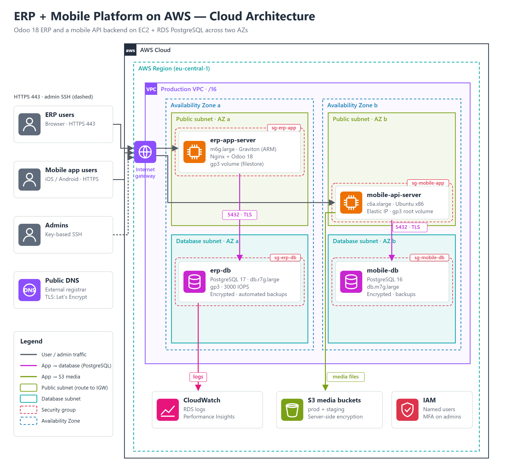

# 01 — Architecture

## 1. Network

| Element | Design | Why |
|---|---|---|
| **VPC** | One production VPC (/16) in one region. Production uses **2 Availability Zones**; a third AZ is reserved for testing | Each system lives in one AZ, so an AZ failure stops only one system. Room to add AZ-redundant tiers later |
| **Public subnets** | One /20 per AZ, route `0.0.0.0/0 → Internet Gateway` | App servers serve HTTPS directly to users and the mobile app |
| **Database subnets** | One /20 per AZ, grouped in an **RDS DB subnet group** | Keeps databases in their own address range, apart from the app tier. The group spans several AZs, so Multi-AZ can be enabled without network changes |
| **Internet Gateway** | One per VPC | Inbound HTTPS, outbound updates |
| **Elastic IPs** | One per app server | Stable addresses for DNS records and partner allow-lists |
| **DNS** | External registrar; A records point to the Elastic IPs | Keeps DNS independent of the AWS account, which helps the DR failover |

The same VPC hosts both workloads. Isolation between them comes from security groups: each tier only accepts traffic from the tier in front of it.

## 2. Compute

| Server | Instance | OS | Role |
|---|---|---|---|
| ERP app server | `m6g.large` (2 vCPU, 8 GiB, **Graviton ARM**) | Ubuntu 24.04 LTS | Nginx reverse proxy + Odoo 18 (multi-worker) + filestore on a gp3 volume |
| Mobile API server | `c6a.xlarge` (4 vCPU, 8 GiB, AMD x86) | Ubuntu LTS | Mobile app API, media uploads to S3 |

**Why Graviton for the ERP:**
- Odoo is pure Python plus PostgreSQL client libraries, so it runs on ARM without changes.
- m6g gives about 20% better price/performance than the m5/m6i equivalents.

**Nginx in front of Odoo:**
- TLS termination with Let's Encrypt (Certbot timer for renewal).
- HTTP → HTTPS redirect.
- Separate upstreams for Odoo's HTTP workers and its websocket / longpolling port.
- Gzip compression.

Odoo itself listens on localhost only.

## 3. Databases

| | ERP database | Mobile database |
|---|---|---|
| Engine | RDS for PostgreSQL **17** | RDS for PostgreSQL **16** |
| Class | `db.r7g.large`, memory-optimized Graviton (16 GiB), suited to Odoo's large working set | `db.m7g.large`, general-purpose Graviton |
| Storage | gp3, 3000 IOPS, storage autoscaling | gp-SSD, storage autoscaling |
| TLS | Enforced: `rds.force_ssl = 1` | Enforced |
| Encryption at rest | KMS | KMS |
| Backups | Automated, 7 days, point-in-time restore | Automated, 7 days |
| Deletion protection | On | On |
| Monitoring | Performance Insights + PostgreSQL logs → CloudWatch Logs | Performance Insights |
| Parameter group | Custom: connection limit sized to Odoo workers, a statement timeout to stop runaway queries, and logical replication for DR | Custom: connection limit for the API pool |

Both databases sit in the database subnet group and accept PostgreSQL connections only from their own app server's IP (plus the DR site for the ERP).

**Why RDS rather than PostgreSQL on EC2:**
- Managed backups, PITR, minor-version patching, storage autoscaling and Performance Insights.
- Lower operational load for a small team.
- What we give up: no superuser and no physical replication outside AWS. The DR design works around that with logical replication; see the [DR repo](https://github.com/altaheri86/odoo-pg-logical-dr).

## 4. Storage

| Store | Use | Protection |
|---|---|---|
| S3 bucket (prod) | Mobile app media | SSE-S3 encryption |
| S3 bucket (staging) | Media for the beta app | SSE-S3 encryption |
| EBS gp3 | OS + Odoo filestore (attachments) | Daily rsync of the filestore to the DR site |

## 5. Request flow

1. A user opens the ERP URL. DNS at the external registrar resolves it to the ERP server's Elastic IP.
2. The Internet Gateway delivers the request to the instance. The security group allows 80/443.
3. Nginx terminates TLS and proxies to Odoo on localhost: HTTP workers, plus the longpolling/websocket port for live updates.
4. Odoo queries RDS over TLS on 5432. The DB security group allows only the app server.
5. Attachments are read from and written to the filestore on the instance's EBS volume.

The mobile flow is the same shape: app → Elastic IP → API server → mobile DB, with media in S3.

## 6. Diagrams

The diagrams in [`../diagrams`](../diagrams) are **generated from code**: a small Python script writes the SVG directly, using AWS architecture-icon colours. The PNGs are rendered from the SVGs.
- The layout stays consistent across diagrams, and changes show up in Git diffs.
- An internal variant of the same script adds real resource names for the operations team.
